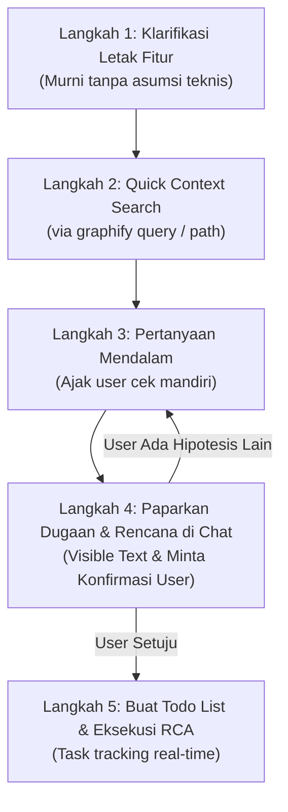

# Deep Investigate Skill 🕵️‍♂️

> **Universal 5-Step Deep Investigation Protocol for AI Coding Agents**  
> Kompatibel lintas sistem operasi (**Windows**, **macOS**, **Linux**) dan berbagai AI Agent (**Google Antigravity**, **OpenCode**, **OpenAI Codex**, **Claude Code**, **Cursor IDE**).

`deep-investigate` adalah skill/rule prosedural yang meniadakan budaya *"asal tebak kode"* (*guesswork*) pada AI Coding Agent dan menggantinya dengan protokol investigasi 5-langkah yang terstruktur, transparan, dan berbasis data kode nyata.

---

## 🚀 Cara Instalasi Paling Mudah & Anti-Gagal (Cukup 1 Prompt)

Tidak perlu menjalankan skrip terminal atau memikirkan path direktori OS. Cukup buka chat AI Coding Agent Anda (apapun aplikasinya dan OS-nya), lalu kirimkan pesan berikut:

```text
Tolong pasang skill deep-investigate dari repository https://github.com/christian-alexander/deep-investigate.git ke konfigurasi agent kamu agar aktif.
```

*(Ganti `<username>` dengan nama akun/organisasi GitHub Anda).*

AI Agent akan otomatis:
1. Mendeteksi sistem operasi Anda (Windows, macOS, atau Linux).
2. Mengunduh file `SKILL.md` dari repository.
3. Menempatkannya pada folder konfigurasi skill yang sesuai (misal: `~/.gemini/config/skills/`, `~/.opencode/skills/`, `.cursor/rules/`, dsb.).
4. Mengonfirmasi bahwa skill telah siap digunakan.

---

## 🎯 Mengapa Skill Ini Dibutuhkan?

Secara default, AI coding assistant sering kali:
1. **Langsung menebak** letak file tanpa konfirmasi letak fitur yang jelas di UI.
2. Melakukan perubahan kode secara membabi-buta (*shotgun debugging*) yang berisiko merusak modul lain.
3. Menaruh analisis di *hidden thoughts* / *collapsible accordion* sehingga pengguna tidak tahu apa yang sedang terjadi.

**Dengan `deep-investigate`, AI dipaksa untuk:**
- **Murni mengonfirmasi letak fitur** terlebih dahulu tanpa asumsi teknis prematur.
- **Memetakan arsitektur kode** menggunakan knowledge graph (`graphify`).
- **Mengajak pengguna aktif** melakukan pengecekan mandiri di awal.
- **Mencetak dugaan & rencana langkah** secara transparan (*visible text*) dan **meminta persetujuan pengguna** sebelum menyentuh file.
- **Mengelola todo list** secara real-time selama investigasi akar masalah (*Root Cause Analysis* / RCA).

---

## 🔄 Alur Protokol 5-Langkah



1. **Langkah 1: Klarifikasi Letak Fitur & Problem Utama (Murni Tanpa Asumsi)**  
   Agent wajib memastikan letak halaman, menu, tombol, dan perilaku yang diharapkan vs aktual. Dilarang menebak status code HTTP atau error console di langkah ini.
2. **Langkah 2: Pencarian Cepat Konteks Kode via Graphify**  
   Agent menelusuri arsitektur dan relasi komponen/endpoint terkait menggunakan `graphify query` untuk memetakan alur data secara otomatis tanpa meminta izin user.
3. **Langkah 3: Pertanyaan Mendalam & Pengecekan Mandiri User**  
   Agent mengajukan pertanyaan teknis lanjutan dan meminta user memeriksa hal spesifik (Console, filter aktif, payload) agar investigasi berbasis data observasi riil.
4. **Langkah 4: Paparan Hipotesis di Chat (Visible Regular Text) & Tanya Konfirmasi**  
   Agent wajib memaparkan **DUGAAN** dan **RENCANA LANGKAH** di pesan chat terbuka (bukan di hidden thought), lalu menanyakan: *"Apakah Anda setuju dengan hipotesis ini, atau ada hipotesis lain?"*
5. **Langkah 5: Pembuatan Todo List & Eksekusi RCA**  
   Setelah user menyetujui, barulah agent membuat todo list pelacak dan mengeksekusi penelusuran akar masalah (*Root Cause Analysis*) hingga tuntas.

---

## 📌 Kriteria Pemicu (*Trigger*) & Pengecualian

| Kategori | Skenario | Tindakan Agent |
| :--- | :--- | :--- |
| **Wajib Trigger** | User lapor bug baru yang belum ada di context window | Aktifkan `deep-investigate` |
| **Wajib Trigger** | User minta buat/edit/hapus fitur baru yang belum dibahas | Aktifkan `deep-investigate` |
| **Pengecualian** | Pertanyaan direct spesifik (misal: *"apa isi tabel users"*) | Langsung cari & jawab |
| **Pengecualian** | Perintah lanjutan dari konteks chat sebelumnya | Langsung eksekusi perubahan |

---

## 📄 Lisensi
MIT License. Bebas digunakan, dimodifikasi, dan dibagikan.
